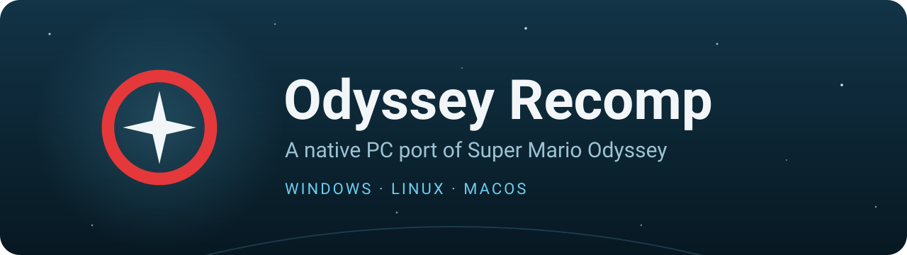
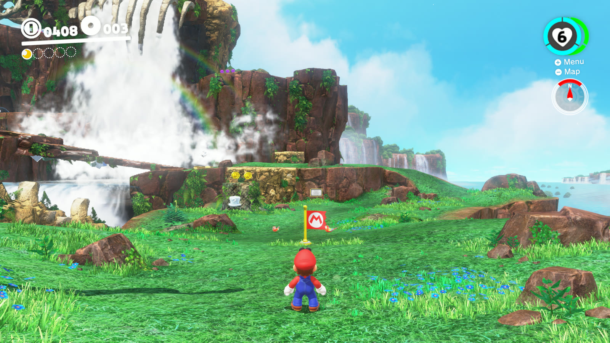
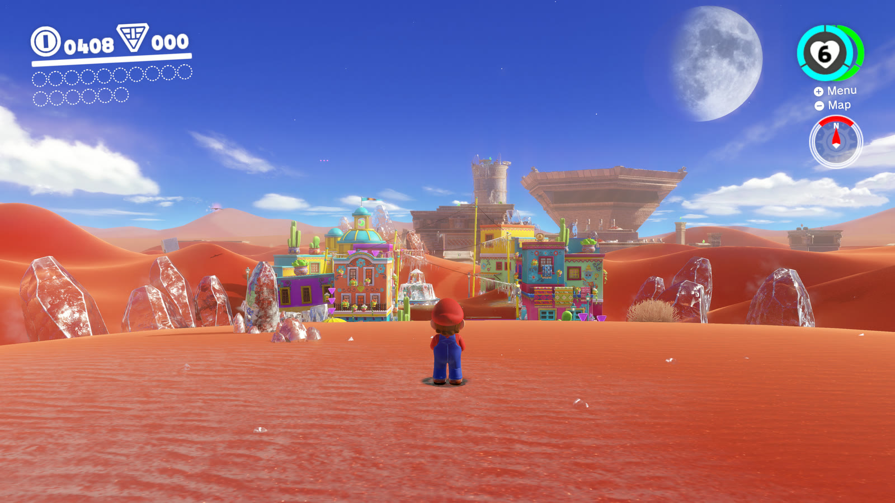
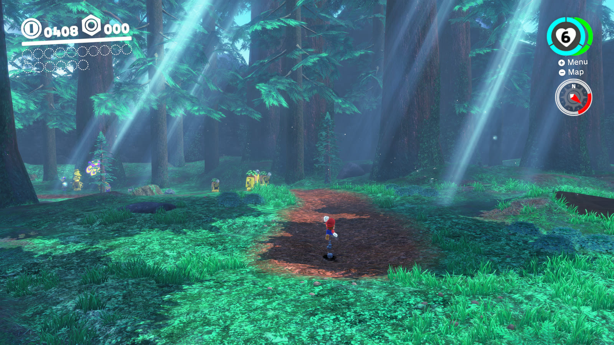
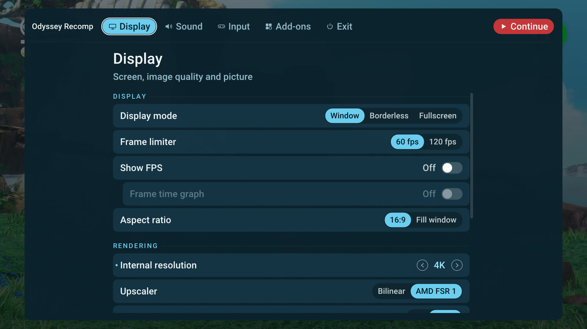

A native PC port of **Super Mario Odyssey** (Nintendo Switch, version 1.0.0) by static recompilation: the game's
ARM64 code is translated to C ahead of time and compiled into a regular program for Windows, Linux or macOS. No
emulator runs at play time; the Switch system parts the game talks to (kernel, services, the NVN graphics API, audio)
are reimplemented on the PC, with Vulkan (Windows, Linux) or Metal (macOS) for graphics.

**You need your own copy of the game.** Nothing of the game is included in the downloads or the source code - no game
code, no assets, no fonts.

> [!NOTE]
> Windows (x64) and Linux (x64): playable. macOS (Apple Silicon): an early test build - expect problems.
> Built with heavy help from an AI coding agent (Claude), directed and tested by a human.

  
  

  
  

Our own screenshots of the Windows version, rendered at 4K. <i>Super Mario Odyssey</i> &copy; Nintendo.

## Download

**[Download the latest release](https://github.com/rwwo8/OdysseyRecomp/releases/latest)** - Windows (x64):
`Odyssey Recomp-<version>-windows.zip`. It's also in [RecompLauncher](https://recomplauncher.com/game/odysseyrecomp),
which installs it, sets it up from your game folder and keeps it updated (Easy Setup, `recomplauncher.json`).

1. Extract the zip into a folder you can write to (Documents or Desktop, not Program Files) and start
   `OdysseyRecomp.exe`. Windows SmartScreen may say "Windows protected your PC" (the program isn't code-signed):
   *More info*, then *Run anyway*.
2. The first time, choose the folder with your game files: Super Mario Odyssey version **1.0.0** (no updates),
   extracted (`exefs` and `romfs`), dumped from your own console. Setup checks the version, copies what the game needs
   next to the program (about 6 GB) and recompiles the game code on your PC - a few minutes, once. Instructions on how
   to dump the game are not provided.
3. Press **Play**. The first start after installing or updating prepares the shaders (about a minute: *Starting...*
   on the Play button); later starts take seconds.

## Features

- **Native PC port** - no emulator at play time; a steady 60 fps on current PCs.
- **Image quality** - internal resolution from 1080p up to 8K (supersampled to your screen), SMAA, AMD FSR 1,
  sharpening, 16x anisotropic filtering, smooth gradients (no banding in skies and fog), brightness and saturation.
- **120 fps** - *Frame limiter: 120 fps* adds an image between each two of the game's frames (needs a 120 Hz+ display;
  an in-between is left out whenever the GPU has no room, so it never costs a game frame).
- **Ultrawide** - *Aspect ratio: Fill window* shows more of the world on 21:9 and 32:9 screens.
- **Window / Borderless / Fullscreen**, F11 or Alt+Enter.
- **Controllers** - Xbox, PlayStation, Switch and others; Nintendo or Xbox / PS button layout, and the game's own
  button prompts drawn as your controller's buttons.
- **Motion controls** - the gyro and accelerometer of PlayStation, Switch Pro and Steam controllers drive the game's
  motion moves (motion cap throws, roll boost); without them, a **Shake** binding (keyboard R by default, any
  controller or mouse button) does the shake.
- **Two players** - the game's own two-player mode: a second controller plays Cappy.
- **Mouse and keyboard** - mouse camera (sensitivity up to 1000%, faster than a stick can turn), every input
  rebindable (keyboard, controller and mouse buttons).
- **Mods** - RomFS mods (costumes, textures, music, levels) from a `mods` folder, switched on and off in the menu.
- **A launcher** - Play, Settings, Controls, and a Game page to choose another game folder or rebuild the game code;
  it tells you when a new version is out and installs it in place (your saves, settings and mods stay).
- **Shaders built ahead** - the game's shaders are compiled before the first start, and every pipeline the game has
  drawn (ours from a run through every kingdom, and your own) is built before it is needed, so new places don't stutter.

## Status

Playable from start to finish: the whole game has been played through without problems - every kingdom, the bosses,
the 2D and 8-bit sections, the ending and the post-game - at 60 fps on a current desktop PC. Linux runs the same way;
macOS is a first test build.

Known issues:
- The first time an area appears, the graphics driver compiles its shaders: a stage you enter for the first time can
  take a second or two to appear, and a new effect can hold the picture for a moment. Everything is cached afterwards
  (`cache/`).
- Only version 1.0.0 of the game runs (no updates).
- The game runs at 60 fps, as on the Switch: its logic is tied to the frame rate. 120 fps is made with in-between
  images (above) and adds about half a frame of latency.
- macOS: a test build; graphics problems are likely.

## What you need

- **Windows** 10 / 11 (x64) or **Linux** (x64, glibc 2.35+: Ubuntu 22.04, Debian 12, Fedora, Arch, SteamOS ...): a CPU
  with AVX2 (Intel Haswell / AMD Zen or newer), a GPU with Vulkan 1.3 and an up-to-date driver
- **macOS** 15 or newer on Apple Silicon (M1 or newer)
- 8 GB RAM (16 GB recommended), about 7 GB free disk space
- Super Mario Odyssey **1.0.0**, dumped from your own console: the `exefs` and `romfs` folders of the game

## Building from source

Needs MSYS2 (clang, SDL3, FFmpeg, shaderc) and Python 3.12 - `tools\setup_windows.ps1` installs them.

1. Put the game files into `extracted\` in this folder: `extracted\exefs\` (main, sdk, subsdk0, rtld, main.npdm) and
   `extracted\romfs\`. Disable updates and mods when dumping: `main` must be 1.0.0 (build id `3ca12dfaaf9c82da`).
2. One-time toolchain setup, in PowerShell from this folder:

       powershell -ExecutionPolicy Bypass -File tools\setup_windows.ps1

3. Build, from Git Bash (or an MSYS2 UCRT64 shell) with MSYS2 first on PATH:

       export PATH="/c/msys64/ucrt64/bin:/c/msys64/usr/bin:$PATH"
       make gen        # recompile the game from extracted/exefs into generated/ (~20 s)
       make -j16       # build/OdysseyRecomp.exe and the game code, build/odyssey_game.dll (~4 min the first time)
       make dlls       # copy SDL3 / FFmpeg / shaderc DLLs next to the exe, so it starts without MSYS2

4. Play: double-click `build\OdysseyRecomp.exe` (or make a shortcut to it). The first start builds
   `extracted\romfs.bin` once. Details are in `build\OdysseyRecomp.log`.

## Controls

The in-game menu: **F1** or **Esc** (controller: Home / Guide button) - video, audio, controls (rebinding), language.

| Switch | Keyboard | Controller |
|---|---|---|
| Left stick | W A S D | left stick |
| Right stick (camera) | Num 8 / 4 / 5 / 6 | right stick |
| A / B / X / Y | K / J / L / I | by position (east = A, south = B) |
| L / R, ZL / ZR | Q / E, 1 / 3 | shoulder buttons / triggers |
| + / - | Enter / Backspace | Start / Back |
| Stick clicks | F / Num 0 | stick clicks |
| D-pad | arrow keys | d-pad |
| Shake (motion) | R | gyro, or any button you bind |

Fullscreen: F11 or Alt+Enter.

## Files

Everything lives in one folder: on Windows the program's folder (a source checkout: the folder
`build\OdysseyRecomp.exe` sits in, or its parent when that has `extracted\`), on Linux
`~/.local/share/odyssey-recomp`, on macOS `~/Library/Application Support/io.github.odysseyrecomp`:

- `extracted\` - your game files as setup made them (`exefs\`, `romfs.bin`) and the game code built from them
  (`odyssey_game.dll`)
- `save\` - your saves, `cache\` - compiled shaders, `odyssey.ini` - settings, `OdysseyRecomp.log` - the log
- `mods\` - optional mods, each in a folder of its own (see below)
- `fonts\` - optional: the Switch's system fonts from your console (see `fonts\README.md`)

## Mods

Mods that replace or add game files work: costumes, models, textures, music, text, levels - RomFS mods, as made for
the Switch emulators. Put each mod in its own folder in `mods\` (in the folder above), with its `romfs` folder inside,
just as it comes: `mods\<Mod name>\romfs\ObjectData\...`. The Atmosphere layout
(`...\atmosphere\contents\0100000000010000\romfs\`) works too. The game's own files stay untouched.

In the menu (**F1**), the **Mods** tab lists them: switch each one on or off, or open the mods folder; changes apply the
next time the game starts. If two mods change the same file, the one higher in the list wins (the folder names in
alphabetical order).

Mods made for version 1.0.0 work best; ones made for later versions of the game may not. Code mods (exefs: IPS /
pchtxt patches, or code like Super Mario Odyssey: Online) can't be used - the game code is recompiled from the
original on your PC - and show up greyed out.

## How it works

- `tools/` - the recompiler (Python): `gen.py` lifts every function of the game's NSO modules to C (`lifter.py`),
  `odyssey_patches.py` holds the few game-specific instruction patches.
- `runtime/` - the program: module loader, a small Horizon kernel (threads, synchronization, memory; threads of one
  Switch core take turns as there), IPC services (file system, audio renderer, input, time, ...), HLE of SDK
  functions, the NVN graphics API on Vulkan with a Maxwell shader translator (`runtime/nvn`), movie playback with
  FFmpeg, the in-game menu (Dear ImGui), the first-start setup (`runtime/ui/setup.mm`, `runtime/gamebuild.c`).
- Debugging tools are environment variables (`ODYSSEY_*`), documented where they are read.

A release is made with `make deps-windows` (an LGPL-only FFmpeg), `make gen-helper` (the generator as a standalone
program), `tools/fetch_zig.sh` (the compiler setup uses on the player's PC) and `make dist` - the zip holds no game code.

## Credits

- **[LAS Recomp](https://github.com/peiikai/LASRecomp)** by Peiikai and its contributors - the static recompiler,
  runtime and renderer this port is built on, and the frame interpolation (MIT license). Huge thanks: without it this
  port wouldn't exist.
- **[OdysseyDecomp](https://github.com/MonsterDruide1/OdysseyDecomp)** - names and structure of the game's code, used
  for reading and debugging (no code from it is in this repository)
- [Switchbrew](https://switchbrew.org) and [envytools](https://github.com/envytools/envytools) - documentation of the
  Switch's system interfaces and the Maxwell GPU
- An MIT-licensed open-source project's audio renderer and shader instruction decoders (license and copyright notice:
  `third_party/ryujinx/LICENSE.txt`) - the audio effects follow its code, its decoders were the bit-layout reference
  for parts of the shader translator
- Libraries: [SDL 3](https://libsdl.org) (zlib), [FFmpeg](https://ffmpeg.org) (LGPL, linked dynamically),
  [Dear ImGui](https://github.com/ocornut/imgui) (MIT), [Vulkan Memory Allocator](https://github.com/GPUOpen-LibrariesAndSDKs/VulkanMemoryAllocator) (MIT),
  [shaderc](https://github.com/google/shaderc) (Apache 2.0), [SMAA](https://github.com/iryoku/smaa) (MIT,
  `third_party/smaa/LICENSE.txt`), [AMD FSR 1](https://github.com/GPUOpen-Effects/FidelityFX-FSR) (MIT,
  `third_party/fsr/LICENSE.txt`),
  the [Roboto](https://github.com/googlefonts/roboto) font of the menu (Apache 2.0, from Dear ImGui's
  `third_party/imgui/misc/fonts`)
- In the release, to build the game code on your PC: [Zig](https://ziglang.org) (MIT) with its
  [LLVM / Clang / LLD](https://llvm.org) (Apache 2.0 with LLVM exception) and MinGW-w64 headers; the generator runs on
  [Python](https://www.python.org) (PSF license), with [Capstone](https://www.capstone-engine.org) (BSD), [Unicorn](https://www.unicorn-engine.org)
  (GPL 2.0) and [LZ4](https://github.com/python-lz4/python-lz4) (BSD). Their sources are at those links; the release
  carries every licence in `licenses/` (with `licenses/README.txt`).

## Legal

This is a fan project. It is not affiliated with, endorsed by or sponsored by Nintendo. *Super Mario Odyssey* is a
trademark of Nintendo. No game files, game code, assets or fonts are included in this repository or its releases, and
nothing built from your game files (`extracted/`, `generated/`, `odyssey_game.dll`) may be shared. You must provide
your own legally obtained copy of the game.

## License

The code of this repository is under the [MIT License](LICENSE) (it keeps the copyright notices of the MIT projects it builds on). Third-party
components keep their own licenses (above, and in `third_party/`). The license covers this project's code only - it
grants nothing for Nintendo's game.
